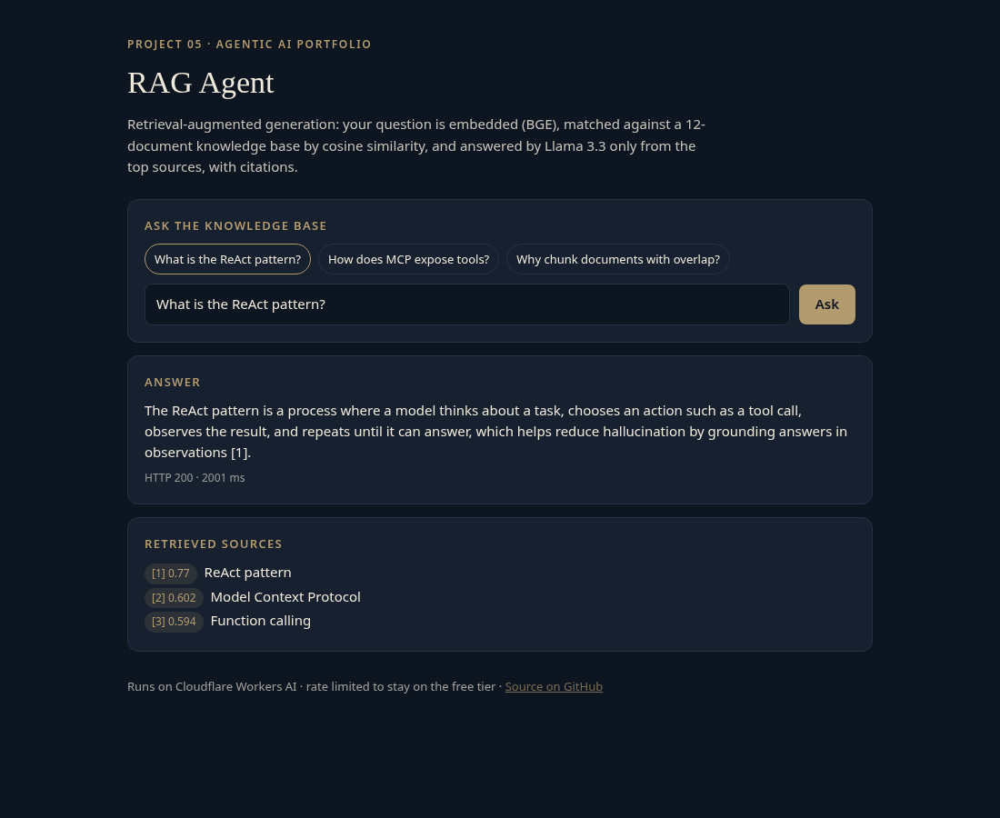
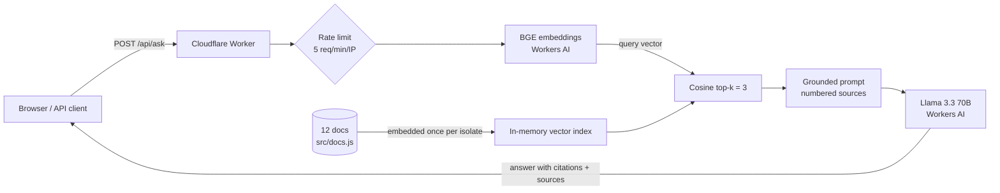

# agent-05-rag

A **retrieval-augmented generation (RAG)** agent that answers only from its knowledge base and cites its sources. It runs serverless on Cloudflare Workers on the free Workers AI tier. Project 5 of a 10-part agentic AI portfolio.

**Live demo:** https://agent-05-rag.braylo777.workers.dev



## What it is
Ask a question. The agent finds the most relevant passages in a 12-document knowledge base about agentic AI, answers from them with `[n]` citations, and says it doesn't know when the sources don't cover it. Each response lists the retrieved sources with their similarity scores.

## Architecture


## How it works
- `src/docs.js`: the knowledge base. Replace it with your own documents.
- `src/rag.js`: embeddings, cosine top-k retrieval and the grounded prompt ("answer only from the numbered sources, cite like [1]").
- No vector database is needed at this size: document vectors are computed once per isolate and kept in memory. For a large corpus, swap in Cloudflare Vectorize.
- Guardrails: 5 requests/min per IP, 500-character cap, answer-only-from-sources instruction.

## Eval results
Run live against the deployed demo (`node evals/run.mjs`) on 20 hand-written questions, each with one gold document and an expected key phrase. Raw per-case output is in [`evals/results.json`](evals/results.json).

| Metric | Result | Definition |
|---|---|---|
| Retrieval hit@1 | **19/20 (0.95)** | Gold document ranked first |
| Retrieval hit@3 | **20/20 (1.00)** | Gold document in the top 3 sent to the model |
| Citation accuracy | **20/20 (1.00)** | Answer cites at least one `[n]`, and every cited `[n]` is the gold document |
| Answer accuracy | **18/20 (0.90)** | Answer contains the expected key phrase |
| Latency p50 / p95 | **844 ms / 2028 ms** (n=20) | End-to-end `/api/ask`, measured from the eval client |

Known misses: in 2 of 20 cases the model replied with only the citation `[1]` and no answer text. The one hit@1 miss ("ranking passages") put the Embeddings doc second, behind the RAG doc. Models: `@cf/baai/bge-base-en-v1.5` and `@cf/meta/llama-3.3-70b-instruct-fp8-fast`. Run on Oct 27, 2026.

## Tests
10 offline unit tests (`node:test`, Workers AI mocked): cosine math and edge cases, top-k ranking, embedding the index once per isolate, retrieval and citation in the prompt, source ref numbering, HTTP input validation, and a model failure returning 502.

```bash
npm test
```

## Run it
```bash
npm install
npm test             # offline unit tests (Node 20+)
npx wrangler dev     # local; Workers AI runs via your Cloudflare login
npx wrangler deploy  # free tier, no paid API keys
node evals/run.mjs   # live eval (throttled to the demo's rate limit); writes evals/results.json
```

## Stack
Cloudflare Workers · Workers AI (Llama 3.3 70B, BGE base embeddings) · vanilla JS · node:test

## License
MIT
